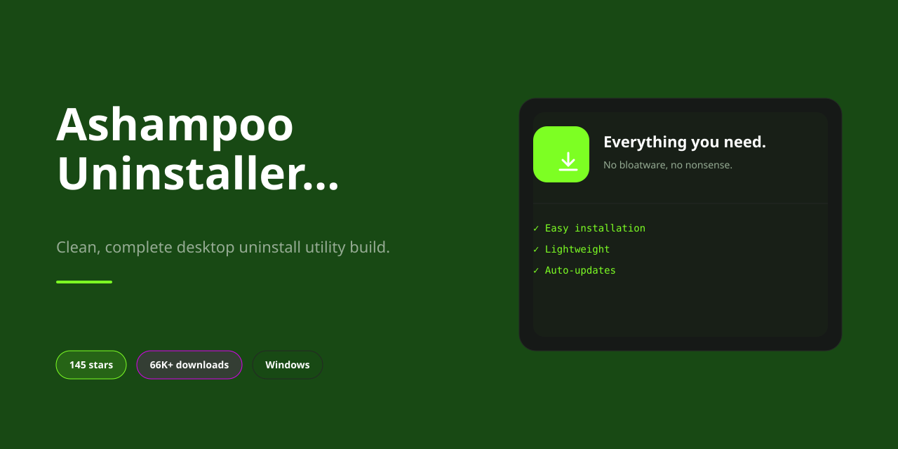

# Ashampoo Uninstaller 2026: Complete Desktop Utility for Windows 11

    

---

This repository delivers a complete, ready-to-run desktop installation build of Ashampoo Uninstaller 2026 for Windows x64 environments, intended for offline deployment and testing workflows. All application features are pre-activated within the package, eliminating post-install configuration steps and ensuring consistent behavior across target machines. The build bundles the full utility set for deep application removal, installation monitoring, and system change tracking in a single distributable package. Engineered for reproducibility, the package supports straightforward provisioning in isolated or air-gapped environments without external dependencies.

## Features

- **Complete Uninstall Engine:** Removes installed applications along with residual files, registry entries, and configuration artifacts that standard uninstall routines leave behind.
- **Installation Monitoring:** Captures system state before and after setup routines to build precise removal manifests for each monitored program.
- **Deep Scan Mode:** Performs recursive filesystem and registry analysis to detect orphaned traces from previously removed or partially uninstalled software.
- **Snapshot Comparison:** Generates and diffs system snapshots to isolate changes introduced by installations, updates, and background services.
- **Leftover Cleanup:** Identifies and clears stale directories, unused registry keys, and temporary data associated with removed applications.
- **Application Inventory:** Enumerates installed programs with metadata including version, publisher, install path, and estimated footprint.
- **Registry Backup and Restore:** Creates rollback points prior to removal operations, allowing restoration of registry state if needed.
- **Scheduled Maintenance:** Supports automated cleanup routines on defined intervals for ongoing system hygiene.
- **Offline Operation:** All functionality is available locally without network dependency; no telemetry or external lookups required.
- **Pre-Activated Build:** Ships with all features enabled and licensing pre-configured, eliminating activation steps during deployment.
- **Windows x64 Desktop Target:** Native support for 64-bit Windows environments with integration into standard system services.
- **Portable Configuration:** Settings and scan databases are self-contained, allowing consistent behavior across deployment targets.

## How it works

The utility operates through a layered installation engine that decomposes every application into its constituent filesystem, registry, and service components before removal. When a target program is selected for uninstallation, the engine first generates a complete snapshot of all associated artifacts — executables, dynamic libraries, configuration files, registry keys, scheduled tasks, and background services. This inventory is compared against a baseline system manifest to isolate program-specific entries from shared dependencies, preventing the removal of runtime libraries required by other software.

During the removal phase, the engine processes each identified artifact through a staged deletion pipeline. Files and directories are marked for removal and verified against in-use handles; locked resources are scheduled for deletion on the next system restart through the native session manager. Registry entries are processed transactionally, with each key backed up to an internal recovery store before modification, allowing rollback if a dependency conflict is detected mid-operation. Service and driver registrations are stopped, unregistered, and removed in dependency order to avoid orphaned handles.

The installation build packages a pre-configured runtime environment that requires no post-install activation or network verification. All feature modules — deep scan, residual cleanup, installation monitoring, and system restore point management — are enabled by default and initialized during first launch. The bundled configuration profile sets scan depth, exclusion rules, and backup retention policies to production-ready defaults, which can be adjusted through the local settings interface without external license validation.

Installation monitoring runs as a background subsystem that hooks into the system's file and registry notification APIs. When a new program is installed while the monitor is active, every write operation is logged to a structured manifest, creating a precise uninstall recipe for later use. This manifest captures not only explicit installer actions but also side effects such as runtime-generated cache directories and per-user configuration branches, which conventional uninstallers typically leave behind.

System restore integration creates a lightweight checkpoint before each uninstallation batch, storing only the registry hive and affected directory metadata rather than a full disk image. If a removal produces unexpected system instability, the checkpoint can be restored independently of the application's own recovery store, providing two independent rollback paths. All operations are logged to a local audit trail with timestamps and artifact counts, and the engine enforces a verification pass after each batch to confirm that no residual entries remain in the scanned scope.

## Requirements

- Windows 10 or Windows 11, 64-bit (x64) editions only; 32-bit and ARM-native environments are not supported.
- Minimum 4 GB of system RAM; 8 GB or more recommended when scanning large application inventories or generating full system snapshots.
- At least 2 GB of free disk space for the installation payload, plus additional headroom proportional to the size of the applications and system state being monitored.
- Administrative privileges are required for installation and for core uninstaller operations, including registry inspection, service removal, and system-level change tracking.
- Microsoft .NET Framework 4.8 or a compatible runtime must be present and enabled on the target system.
- A display resolution of 1280×720 or higher for the full management console layout.
- Persistent local storage is required for installation logs, backup snapshots, and restore points; network or removable volumes are supported only as secondary backup targets.
- Outbound network access is not required for core operation; the build is designed to function fully in offline and air-gapped environments.
- Standard user account control settings must permit elevation prompts; restrictive group policy configurations that block elevated execution will prevent installation and monitoring features from initializing.
- Sufficient permissions on the target installation directory and system registry hives to allow the utility to create, modify, and roll back tracked changes.

## Compatibility

**Operating Systems:** The build targets 64-bit Windows desktop environments, with validated support for Windows 10 (version 1809 and later) and Windows 11 across current mainstream and servicing branches. Legacy 32-bit Windows installations are not supported, and the installer will halt with an architecture mismatch notice on such systems.

**Runtime Dependencies:** No external runtime, framework, or redistributable installation is required. All managed libraries and native components are bundled within the release package, allowing the utility to operate on systems with a minimal software baseline or restricted update channels.

**File System and Storage:** A minimum of 2 GB of free disk space is required for installation and working data. The application performs best on local NTFS volumes; network shares and removable media are supported for portable operation but may introduce latency during snapshot and restore operations.

**Hardware Baseline:** A dual-core processor at 1.5 GHz or higher, 4 GB of system memory, and a display resolution of 1280x720 or greater are recommended. Systems below this baseline remain functional but may experience extended processing times during large-scale uninstall and trace operations.

**Privilege Model:** Full functionality requires administrative elevation for system-wide installation tracking, registry monitoring, and service management. Standard user contexts support inspection and reporting features but cannot commit removal operations affecting protected system locations.

**Virtualized and Remote Environments:** The build has been validated on common hypervisor platforms and supports execution within virtual desktops and remote session hosts. Graphics-accelerated UI effects degrade gracefully to software rendering where no GPU is exposed.

**Coexistence:** The utility operates alongside third-party security suites, backup agents, and endpoint management tools. Where competing monitoring drivers are present, the installer detects conflicts and offers a compatibility mode that limits real-time tracking to user-scoped changes.

**Forward Compatibility:** Minor Windows feature updates are supported without reinstalling the application. Where a servicing update alters system component behavior, the build applies internal compatibility profiles automatically on next launch.

## FAQ

**Is this build pre-activated, and does it require a separate license key or online sign-in?**

No. The build ships with all features pre-activated at the package level, so no product key entry, account sign-in, or activation server callback is required during or after setup. Feature gating is resolved locally, which means the utility remains fully functional in air-gapped or offline environments. If a future maintenance release changes activation handling, that will be documented in the release notes accompanying that build.

**Which Windows versions and architectures are supported?**

The installer targets Windows x64 desktop platforms. It is intended for 64-bit editions of Windows 10 and Windows 11, and for Windows Server releases in the same generation where the desktop runtime components are present. 32-bit (x86) and ARM-native environments are not supported targets; on ARM devices, x64 emulation may allow the application to run, but this configuration is untested and unsupported.

**What are the disk space and runtime prerequisites?**

Plan for approximately 1.5 GB of free disk space for the installed application, plus additional headroom for logs, snapshots, and installation-tracking data generated during use. The uninstaller maintains records of monitored installations, so the data directory will grow in proportion to the number of tracked packages and the depth of the snapshots retained. Administrative privileges are required for the installer and for uninstall operations that touch system-wide registry hives and protected directories.

**How does the uninstaller track application installations?**

The utility works by capturing system state — file system deltas, registry modifications, and service or driver registrations — before and after an installation runs. The resulting snapshot pair becomes the basis for a complete removal later. For applications installed outside a monitored session, the tool falls back to heuristic scanning of standard install locations, registry uninstall entries, and known vendor paths to reconstruct a removal plan. Removal depth is configurable, from conservative (only confirmed artifacts) to thorough (including orphaned registry keys and leftover configuration files).

**Can I review changes before anything is removed?**

Yes. Every uninstall operation produces a reviewable plan listing the files, directories, registry keys, and services slated for removal. You can deselect individual entries before committing. A restore point and a reversible backup of removed items are created by default, and the backup retention policy is adjustable in settings.

**Does the build support silent or unattended deployment?**

The installer accepts standard silent-install parameters for scripted rollout across managed fleets. Post-install behavior — such as whether the monitoring agent starts at logon and whether telemetry-style local logging is enabled — is controlled through configuration rather than interactive prompts, making the build suitable for standardized desktop images and lab provisioning.

**What should I do if the installer is flagged by security software?**

Heuristic and reputation-based scanners occasionally flag unsigned or newly published installers. Verify the package checksum against the value published with the build before running it. If a false positive is confirmed, add a scoped exclusion for the installer path, complete the setup, and remove the exclusion afterward. Do not disable real-time protection globally or leave exclusions in place longer than necessary.

**How do I verify the integrity of the downloaded package?**

Compare the SHA-256 digest of the downloaded archive against the checksum published alongside the release. A mismatch indicates a truncated or altered download and the package should be discarded and re-obtained from the original source. Integrity verification is strongly recommended before deployment to any managed environment.

**Are automatic updates included, and will they affect the pre-activated state?**

The build does not phone home for feature activation, but it can check for application updates if that option is enabled. Because updates replace binaries, an update may reset the activation state of the package. For environments that require a pinned, reproducible configuration, disable the update check and manage version rollouts manually.

**Where are logs and configuration stored, and can they be relocated?**

Application logs, snapshot databases, and configuration files live under the user profile and the system-wide application data directory by default. Both locations can be redirected through settings — useful for keeping large snapshot stores on a separate volume or for centralizing logs in a lab environment. Log verbosity is adjustable for troubleshooting without affecting normal operation.

## Disclaimer

This build is distributed as a standalone, pre-configured desktop package intended for evaluation, testing, and controlled deployment scenarios. It is provided on an as-is basis, without warranties or guarantees of any kind, whether express or implied, including but not limited to fitness for a particular purpose, merchantability, or non-infringement. The package is assembled to be self-contained: it bundles the runtime dependencies required for the utility to operate in an offline environment and does not require network access during execution.

Because the build ships pre-activated, activation state, licensing, and feature availability are determined at packaging time and may not reflect the terms under which the underlying software is licensed for production or commercial use. Users are responsible for verifying that their use of this package complies with all applicable license agreements and local regulations. Redistribution, resale, or incorporation into commercial products is not sanctioned by the maintainers of this build.

The maintainers make no representations regarding the accuracy, completeness, or reliability of the bundled components. Any diagnostic output, feature behavior, or system modification performed by the utility is provided for informational and testing purposes only. Users assume full responsibility for any changes made to their system, including registry entries, filesystem state, and installed application data, and are strongly advised to create a full system backup or snapshot before running the utility in any environment where data integrity matters.

No support, maintenance, or update obligation is assumed by the maintainers. The build may become incompatible with future operating system updates, security patches, or hardware configurations. Users deploying this package in a production or shared environment should perform their own validation, security review, and compatibility assessment prior to rollout. By downloading, installing, or executing this package, users acknowledge that they have read and understood this disclaimer and accept full responsibility for the outcomes of its use.

